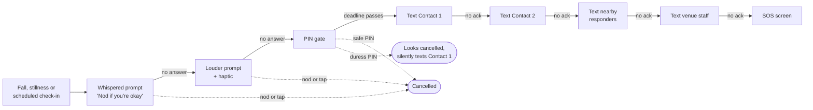
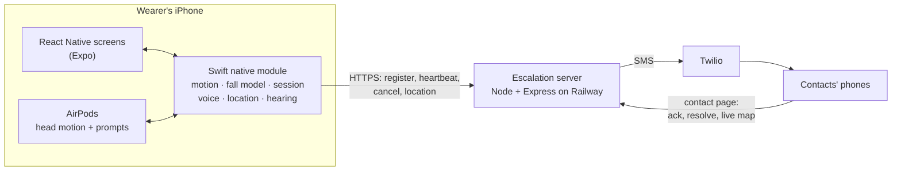

# Guardian

**Help that starts when you can't ask for it.** Guardian turns the AirPods people already wear at a concert into a safety check-in. It notices a fall or long stillness, whispers *"Nod if you're okay"*, and if you can't answer, a server texts your trusted contacts, even if your phone has died.

Built for **Project KAZE** at Hack the Valley: *how might we help people stay safe and get assistance when they are no longer in a position to ask for help themselves?* Guardian does not detect drugging, diagnose anyone or predict what happened. It notices that someone stopped answering and gets a person to check.

> The codebase calls the app **RaveGuard**; texts and the contact page are branded **Guardian**.

## How it works



1. **Detection on the phone.** AirPods head tracking (about 50 Hz) feeds a fall detector, a stillness trigger and a nod detector. A small Create ML model scores each possible fall, with hand-tuned thresholds as its fallback.
2. **The least effort to cancel.** A nod or a tap cancels either prompt. Only the PIN gate needs a PIN.
3. **The server owns the clock.** When a check-in starts, the phone registers a deadline with the escalation server. From then on the server works down the chain whether or not the phone is still online.
4. **Contacts install nothing.** Each text links to a mobile page with the brief, a live location link (if permitted), **I'm on it** and **Mark resolved**.

| Real use | Demo |
| --- | --- |
| Contact 1 texted 70 s after the check-in starts | 20 s |
| 2 min per recipient to acknowledge | 10 s |
| SOS screen at 7 min 10 s | 50 s |

## Features

| Area | What it does |
| --- | --- |
| Fall model | A 7 KB boosted tree that scores every possible fall on 14 head-motion features, then needs 10 s of stillness. On held-out couch takes: 10 of 10 falls caught, 0 of 5 sit-downs, 0 fires in 30 min of simulated dancing |
| Check-in ladder | Whisper, then louder prompt with haptic, then PIN gate; scheduled check-ins every 30 or 60 min |
| Server-owned escalation | Deadline sweep, ordered recipients with acknowledgement windows, SOS flag, retried cancels, idempotent registration, and restart recovery from a snapshot |
| Duress PIN | Same screen, timing and haptic as a safe cancel; silently fires the alert with a "do not call or text openly" warning |
| Per-contact privacy | Each recipient's permissions (alerts, location, full brief, resolve) are enforced by one server function used by the SMS, the page and the map link |
| Live location | One fix at check-in start, live updates only while an alert is open; each tap of the link opens Google Maps at the newest fix |
| Nearby responders | Opt-in users within 250 m are texted after the wearer's own contacts. Their location is rounded to about 110 m and kept in memory only |
| False alarms | Nod, tap or PIN; contacts can mark an alert resolved; a late cancel texts an all-clear |
| Hearing protection | Mic level and estimated dose drive AirPods between Adaptive and Noise Cancellation through iOS Shortcuts: the everyday reason to keep the AirPods in |
| On-device log | Every check-in, cancel and escalation goes to a JSON Lines file that never leaves the phone |

## Architecture



Everything that must keep running with the screen locked lives in Swift. React Native only draws screens and sends taps down.

## Repository layout

```text
app/                                Expo React Native app (TypeScript)
  src/                              Screens, settings, setup, PIN gate, Debug panel
  modules/raveguard-native/
    index.ts, src/                  JavaScript API of the native module
    ios/                            Swift native module
      Motion/                       Head motion, fall model, detectors, replay harness
      Session/                      Check-in state machine, session log, brief facts
      Location/                     CoreLocation source, nearby-responder beacon
      Escalation/                   Server client, offline fake
      Noise/  Audio/  Voice/  Hearing/   Noise control, audio session, prompts, level and dose
      Module/                       Runtime that wires it all to the Expo module
      Shared/Contracts.swift        Types shared across the team
server/                             Escalation server, SMS, contact page
ml/                                 Training-data augmentation for the fall model
docs/                               Design, plans and handoffs
PRD.md, WORK_ORDER.md               Requirements and task ownership
```

## Getting started

### Requirements
- macOS with Xcode 16 or later, and an iPhone with iOS 17 or later
- AirPods with head tracking (AirPods Pro, AirPods Max, or AirPods 3rd generation or later)
- Node.js 22

### The escalation server
```sh
cd server
npm ci
PORT=3000 npm start            # simulate mode: no texts are sent
curl http://localhost:3000/health
```

| Variable | Purpose |
| --- | --- |
| `PORT` | Port to listen on |
| `SMS_MODE` | `simulate` (default) or `live` |
| `TWILIO_ACCOUNT_SID`, `TWILIO_AUTH_TOKEN`, `TWILIO_FROM_NUMBER` | Twilio credentials, required in live mode |
| `PUBLIC_BASE_URL` | HTTPS origin used in contact links, required in live mode |
| `SMS_ALLOWED_RECIPIENTS` | Comma-separated E.164 numbers the server may text, required in live mode |
| `DATA_DIR` | Optional; enables the snapshot so pending alerts survive a restart |
| `TRUST_PROXY_HOPS` | Reverse-proxy hops in front of the server (2 on Railway) |

Set secrets only in your host's environment, never in the repo. See [`server/README.md`](server/README.md) for the full API.

### The iPhone app
Expo Go can't load the native module, so the app runs as a dev build.

```sh
cd app
npm ci
cp .env.example .env.local     # set RG_BUNDLE_SUFFIX; RG_SERVER_URL to use a server
npx expo prebuild --platform ios
npm run ios:device             # pick your iPhone
```

Without `RG_SERVER_URL`, the app uses an offline fake escalation service, so nothing is sent. Rerun `npx expo prebuild` after pulling native changes: `expo run:ios` only prebuilds when `app/ios` is missing. See [`app/README.md`](app/README.md) for signing and troubleshooting.

## Testing

All testing uses simulations only. No real emergency calls, drug exposure or incapacitation.

| Suite | Command |
| --- | --- |
| Swift: motion, fall model, session, location, runtime | `cd app/modules/raveguard-native/ios && swift test` |
| Server: engine, SMS, privacy filter, routes | `cd server && npm test` |
| App: screens, settings, setup, PIN gate | `cd app && npm test && npm run typecheck && npm run lint` |
| Fall model evaluation (Create ML, macOS) | `cd app/modules/raveguard-native/ios && swift run fall-lab compare` |
| End to end against a running server | `RG_E2E_SERVER_URL=http://localhost:3000 swift test --filter SessionServerClientE2E` |

Every scenario in the KAZE brief can be fired from the app's **Debug** screen:

| # | Scenario | What happens |
| --- | --- | --- |
| 1 | Safe | The wearer nods; the prompt stops and nothing is sent |
| 2 | No response | The server texts Contact 1 at the deadline |
| 3 | Duress | The wearer's screen shows a normal cancel; Contact 1 gets an urgent text |
| 4 | Connectivity failure | The phone goes offline after registering; the server still fires |
| 5 | Unacknowledged | The chain moves on to Contact 2, nearby responders, venue staff, then SOS |
| 6 | False alarm | A contact marks it resolved, or the wearer cancels before the deadline |
| 7 | Privacy | A contact without location permission gets a reduced text with no location |

## Privacy and safety principles

- **No raw data leaves the phone.** Motion data and audio never do; the mic only measures loudness and is never recorded.
- **Location only during a check-in**, and live only while an alert is open. Nearby-responder location is a separate opt-in.
- **Permissions are enforced on the server**, so a bug on the phone can't reveal more than each contact is allowed.
- **The duress record exists only on the device.**
- **It never dials an emergency number on its own.** A test fails the build if one appears in the native code.

## Status and limitations

| Status | Item |
| --- | --- |
| Real in the prototype | AirPods motion, the fall model, nod detection, voice prompts, the hosted server countdown, real texts, live location, duress, noise-mode switching |
| Simulated | The emergency itself (Debug button or couch falls), the SOS call (it dials a teammate), and the compressed demo timings |
| Still to validate | False alarms across many people, real dancing and hard floors (the model is trained on one person's data, and lie-downs are untested); a full locked night and battery drain; SMS delivery in a crowded venue; mic calibration; use by someone distressed or impaired |
| Known gap | If the phone dies before a check-in starts, nothing escalates yet. A lost-contact watchdog is planned |

## Team

| Member | Area |
| --- | --- |
| Kean | React Native app, native module, fall model |
| Moses | Noise control, audio session, voice prompts |
| Justin | Motion detection, check-in session, session log, location, nearby responders |
| Andy | Escalation server, SMS chain, contact page, server client |

Requirements are in [`PRD.md`](PRD.md) and task ownership is in [`WORK_ORDER.md`](WORK_ORDER.md).
